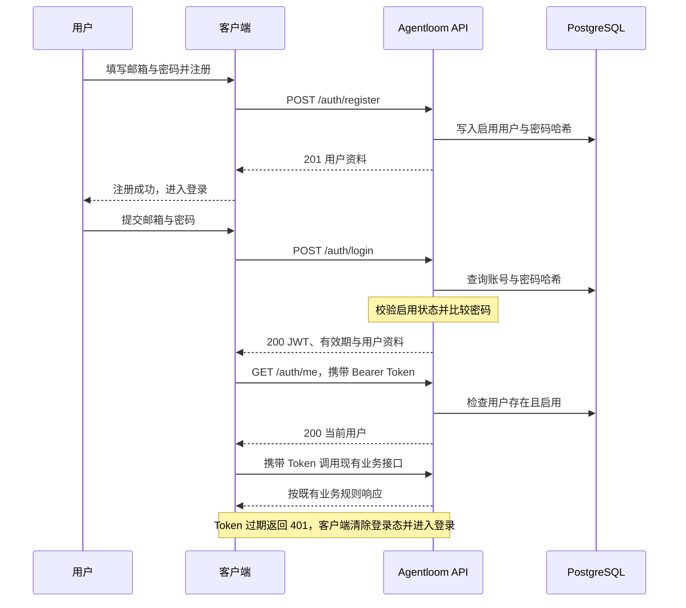

# 用户账号与权限：交互契约与分步实施计划

> 本文定义注册登录功能的交互、接口、实施顺序和验收标准，结构沿用 [仓库初始化计划](repository-initialization-plan.md)。
> 注册、登录、当前用户与业务认证已实现；各阶段完成情况以第 6 节验收记录为准。
> 权限规则以 [权限设计](authorization-design.md) 为准；退出语义仍有一项待确认，见第 2.5 节。

## 1. 目标与范围

在现有 Fastify、PostgreSQL 和 JWT 认证基础上增加本地账号：

- 使用邮箱和密码自助注册，注册成功后账号直接启用。
- 使用邮箱和密码登录，由 Agentloom 签发有效期为 7 天的 HS256 JWT。
- 查询当前登录用户，继续使用现有 Bearer Token 调用业务接口。
- 每次受保护请求检查用户是否存在、是否启用。
- 所有用户的业务能力相同，继续按可信 `userId` 隔离会话。
- 沿用现有错误响应、日志脱敏、自动路由加载和编译产物集成测试。

本期不实现邮箱验证、邮件发送、密码找回或修改、第三方登录、MFA、刷新 Token、用户管理后台、管理员初始化、角色差异、动态授权或用户用量配额。

注册与登录不设置限流、密码派生并发控制或额外的账号探测防护，不以防滥用配置和负载压测作为验收条件。

不新增 `tokenVersion`、bitmap 或尚未生效的角色权限字段。不迁移旧用户身份，不根据旧 JWT 或 checkpoint 自动创建账号，也不补绑旧会话。

本计划是账号功能的增量计划；既有会话、模型、执行、审批与部署能力继续使用，不重新建设。

## 2. 实现约束

### 2.1 接入边界

| 位置                            | 职责                                                          |
| ------------------------------- | ------------------------------------------------------------- |
| `src/plugins/auth.ts`           | 验证 JWT，检查用户存在及启用状态，将用户 UUID 映射为 `userId` |
| `src/database/schema.ts`        | 保存用户、会话归属、模型配置及审批审计                        |
| `src/routes/auth/`              | 通过 autoload 提供公开注册、登录与受保护的当前用户接口        |
| `src/runtime/execution.ts`      | 在共享业务入口校验会话归属                                    |
| `src/plugins/errors/handler.ts` | 统一映射 `AppError` 与 Zod 错误                               |
| `tests/auth-helpers.ts`         | 准备真实用户，签发正常及异常测试 JWT                          |

保留 `@fastify/autoload` 自动注册 `plugins/` 与 `routes/`，不改成手工逐项注册。公共认证插件使用 `fastify-plugin` 共享作用域；注册和登录保持公开，认证 hook 仅挂在受保护接口上，不误保护同目录下的公开接口。

实现使用现有依赖及 Node.js 标准库，不为账号功能增加分层框架、通用 Repository 或可替换认证适配层。默认不修改 `package.json`、脚本、TypeScript/Vitest 配置或 `README.md`；必要的用户操作说明先放在 `docs/`。

### 2.2 用户数据

`src/database/schema.ts` 是业务 schema 的唯一来源，新增下表：

| 字段            | 数据库类型  | 约束与用途                                            |
| --------------- | ----------- | ----------------------------------------------------- |
| `id`            | UUID        | 主键，由服务端生成；作为 JWT 的 `sub` 和业务 `userId` |
| `email`         | text        | NOT NULL；保存规范化邮箱，建立唯一索引                |
| `password_hash` | text        | NOT NULL；保存算法、参数、随机盐和哈希结果            |
| `enabled`       | boolean     | NOT NULL，默认 true                                   |
| `created_at`    | timestamptz | NOT NULL，默认当前时间                                |
| `updated_at`    | timestamptz | NOT NULL，默认当前时间                                |

不增加 CHECK 或外键。现有 `conversations.user_id`、`approval_audits.user_id` 继续保存用户 ID 字符串，不为账号功能额外重构这些字段。

邮箱在注册和登录时使用同一规则：去掉首尾空白、转为小写，再校验格式及不超过 254 字符。保留点号和 `+` 后缀，不做邮箱服务商特定改写。邮箱唯一性由数据库保证，不能只依赖插入前查询。

初始化继续只有 `pnpm db:init`：删除并重建目标 database，再创建当前业务表与官方 checkpoint 表。它会清除全部现有数据；API 启动不初始化数据库，不维护旧库迁移或历史账号兼容。

### 2.3 密码

- 使用 Node.js 异步 `crypto.scrypt` 和至少 16 字节的独立随机盐；同一密码注册两个账号也不能得到相同存储值。
- 起始参数采用 `N = 131072`、`r = 8`、`p = 1`，显式设置 `maxmem = 256 MiB`。
- 使用定长派生密钥和 `timingSafeEqual` 比较。算法、参数、盐和结果保存在同一个 `password_hash` 中，不增加独立密钥或 pepper 配置。
- 首版无 MFA，密码采用 15–128 字符；允许空格，不要求大小写、数字或符号组合，不 trim、不截断。
- 登录先检查账号是否存在且启用，再验证密码；账号不存在、密码错误或账号停用均返回 `401 Invalid credentials`。

### 2.4 JWT 与请求身份

继续复用 `AUTH_JWT_SECRET` 和 `@fastify/jwt`，由服务端签发：

| Claim | 约定                    |
| ----- | ----------------------- |
| `sub` | 本应用生成的用户 UUID   |
| `iat` | 签发时间，Unix 秒       |
| `exp` | `iat + 604800`，即 7 天 |

固定 HS256，验证签名与必需的 `exp`、`sub`，并在查询用户前校验 `sub` 为 UUID；存在 `nbf` 时按现有库能力验证。过期不自动续期，重新登录可得到新的 Token；多个设备可以同时登录。

JWT 不保存密码、邮箱、角色或权限快照。每个受保护请求验签后查询当前用户；不存在或停用返回 401。数据库异常按既有脱敏 5xx 路径处理，不被笼统捕获成 401。

可信执行身份仍为 `{ userId }`。账号资料留在 HTTP 认证层，不将完整用户行传入 Agent、会话写入或审批审计。

禁用检查只影响后续请求，不主动终止已经开始的 Agent 调用或 SSE。恢复、审批与取消请求仍需重新认证，并执行既有归属检查。

### 2.5 退出语义：待确认项

已经确认 JWT 有效期为 7 天，并且不采用 `tokenVersion`。此前提出的“退出时全部设备失效”尚未明确取消，其他服务端撤销机制也未确定。

| 选择       | 用户交互与服务端行为                                                                     | 当前状态                 |
| ---------- | ---------------------------------------------------------------------------------------- | ------------------------ |
| 仅本地退出 | 客户端清除当前 Token；其他设备和已经复制的 Token 仍可使用到过期，无需新增退出接口        | 待确认是否接受改变原要求 |
| 全设备退出 | 服务端撤销该用户所有现有登录凭证，客户端清除本地 Token；需要选择服务端会话或撤销记录方案 | 保留原要求时必须继续设计 |

不能把清除客户端 Token、返回一个空成功响应或禁用整个账号当作全设备退出；也不通过换名字段重新引入凭证版本。

本节未确认前，不定义 `POST /auth/logout` 的成功契约，不增加会话或撤销表，也不将退出功能标记为完成。注册、登录和当前用户接口可以先独立实施。

### 2.6 权限

本期所有认证用户仍可查询、管理全局 Provider 与模型配置，并使用已启用模型。会话的查询、输入、继续、取消和审批仍只允许所属用户操作。

后续真正出现差异化需求时，再增加简单的 `user`、`admin` 角色，由代码映射到 `model:manage`、`provider:manage` 等命名权限。业务入口检查具体能力，资源归属独立检查；管理员名称不自动绕过会话隔离。

按资源限制模型使用、共享会话或动态配置角色均不在本期预建。详细规则只维护在 [权限设计](authorization-design.md)，本计划不复制权限目录。

## 3. 用户交互与接口契约

首版采用注册与登录分开的交互，注册成功不自动签发 Token。

### 3.1 交互顺序



客户端加载已登录页面时可通过 `/auth/me` 确认身份。收到 401 时清除本地登录态并进入登录，不静默续签，也不自动重新提交可能触发 Agent 执行的业务请求。网络错误或 5xx 作为请求失败处理，不误判为密码错误或 Token 失效。

### 3.2 接口概览

| 方法与路径            | 认证       | 请求                  | 成功响应                                           |
| --------------------- | ---------- | --------------------- | -------------------------------------------------- |
| `POST /auth/register` | 公开       | `{ email, password }` | 201，`{ user }`                                    |
| `POST /auth/login`    | 公开       | `{ email, password }` | 200，`{ accessToken, tokenType, expiresIn, user }` |
| `GET /auth/me`        | Bearer JWT | 无请求体              | 200，`{ user }`                                    |

`user` 只包含 `id`、`email`、`createdAt`。请求使用严格 Zod schema；注册和登录不接受 `id`、`userId`、`enabled`、`role`、`permissions` 等额外字段。账号响应使用 `Cache-Control: no-store`，不设置 Cookie。

注册与登录请求示例：

```json
{
  "email": "alice@example.com",
  "password": "a long example passphrase"
}
```

注册成功示例：

```json
{
  "user": {
    "id": "c13bb49d-98eb-4927-8ad6-b0d158b18762",
    "email": "alice@example.com",
    "createdAt": "2026-01-01T00:00:00.000Z"
  }
}
```

登录成功示例：

```json
{
  "accessToken": "<JWT>",
  "tokenType": "Bearer",
  "expiresIn": 604800,
  "user": {
    "id": "c13bb49d-98eb-4927-8ad6-b0d158b18762",
    "email": "alice@example.com",
    "createdAt": "2026-01-01T00:00:00.000Z"
  }
}
```

登录后的请求继续使用现有方式：

```http
GET /auth/me
Authorization: Bearer <JWT>
```

`/auth/me` 的响应与注册成功的 `{ user }` 结构一致。有效期以服务端 JWT 校验为准，客户端显示的倒计时只用于交互。

### 3.3 错误与脱敏

沿用 `{ error, requestId }` 和 `x-request-id`，不增加第二套错误码协议。

| 场景                                         | HTTP 状态    | `error`                    |
| -------------------------------------------- | ------------ | -------------------------- |
| 邮箱、密码或请求字段不合法                   | 400          | `Invalid request`          |
| 规范化后的邮箱已存在                         | 409          | `Email already registered` |
| 登录账号不存在、密码错误或账号停用           | 401          | `Invalid credentials`      |
| Token 缺失、错误、过期或对应用户不存在、停用 | 401          | `Invalid request`          |
| 访问其他用户会话                             | 404          | `Not found`                |
| 数据库或内部异常                             | 既有脱敏 5xx | 沿用根错误处理器           |

注册只将邮箱唯一索引冲突映射为 409；插入使用指定邮箱列的 `ON CONFLICT DO NOTHING`，其他数据库错误保持异常路径。401 受保护接口返回现有 `WWW-Authenticate: Bearer`。

响应、日志及 SSE 不包含密码、哈希、盐、完整 Token 或底层数据库错误。继续使用现有日志字段和凭证脱敏规则，不新增账号请求体日志。

### 3.4 本地操作

先完成 `.env` 配置和 PostgreSQL 启动，再初始化数据库并启动 API：

```sh
node --import tsx scripts/init-env.ts
pnpm db:init
pnpm dev
```

`pnpm db:init` 会删除并重建 `DATABASE_URL` 指向的整个数据库，清除用户、会话、配置和 checkpoint。API 启动不执行初始化。

使用邮箱和 15–128 个 Unicode 字符的密码注册，然后单独登录；密码允许空格并原样保留：

```sh
curl -i http://127.0.0.1:3000/auth/register \
  -H 'Content-Type: application/json' \
  --data '{"email":"alice@example.com","password":"a long example passphrase"}'

curl -i http://127.0.0.1:3000/auth/login \
  -H 'Content-Type: application/json' \
  --data '{"email":"alice@example.com","password":"a long example passphrase"}'
```

把登录响应的 `accessToken` 放入后续请求的 Bearer 头：

```sh
curl -i http://127.0.0.1:3000/auth/me \
  -H 'Authorization: Bearer <accessToken>'
```

同一个 Token 可调用 `/providers`、`/models` 和所属用户的 `/conversations` 接口，模型配置示例见 [模型配置说明](model-configuration.md)。Token 过期后重新调用 `/auth/login`。当前未提供退出接口，第 2.5 节仍需确定退出语义。

## 4. 分步实施与验收

按 Step 1–5 推进，Step 4 受第 2.5 节待确认项约束。每步交付具体代码、必要的核心测试和对应 `docs/` 说明，不以空接口或未来步骤弥补本步缺失。文档编写完成不代表任何实施步骤已经完成。

### Step 1：用户数据与密码核心

**交付：可初始化的用户表，以及可验证的密码哈希与比较函数。**

实施：

1. 在现有 schema 增加 `users` 和邮箱唯一索引，复用数据库初始化入口。
2. 使用少量账号业务文件实现邮箱规范化、密码派生与校验，不新增依赖或配置开关。
3. 密码校验通过账号集成测试验证；schema 与邮箱唯一性通过数据库集成测试验证。

验收：

- [x] 独立测试库可通过现有初始化流程创建用户表，无角色、bitmap、版本、会话或撤销字段。
- [x] 同密码使用不同随机盐，正确密码可验证，错误密码不可验证，明文不落库。
- [x] 邮箱大小写与首尾空白按统一规则处理，并发写入同一规范化邮箱最多成功一条，由数据库保证唯一性。

### Step 2：公开注册与登录

**前置：Step 1。交付：第 3 节注册、登录接口和 7 天 JWT。**

实施：

1. 通过现有 routes autoload 增加严格请求 schema、注册写入与登录校验，保持公开访问。
2. 注册仅返回公开用户资料；登录使用已有 JWT 插件签发 Token，复用配置密钥。
3. 对业务错误使用 `AppError`，沿用统一错误处理器、日志和响应缓存策略。
4. 用真实 PostgreSQL 的账号集成测试覆盖公开成功路径、邮箱冲突、凭证失败和请求字段边界。

验收：

- [x] 自助注册直接启用，重复规范化邮箱返回 409；并发冲突不泄露 SQL。
- [x] 登录签发的 JWT 使用 HS256，`sub` 对应用户 ID，`exp - iat = 604800`。
- [x] 错误密码、不存在账号和停用账号返回一致的 401；未知字段返回 400。
- [x] Token 与用户响应不包含密码、哈希、权限或版本字段，日志不泄密。

### Step 3：可信账号身份与现有业务接入

**前置：Step 2。交付：当前用户接口，以及依赖真实用户记录的业务认证。**

实施：

1. 在共享认证插件验签后加载用户并检查启用状态；数据库错误与凭证错误分开处理。
2. 增加受保护的 `/auth/me`，执行身份保持 `{ userId }`；`/health` 继续公开。
3. 更新业务测试用户准备逻辑，保留已有签名异常测试；其他业务用例可复用真实用户 fixture，不必每例重复执行注册和密码派生。
4. 覆盖会话列表、查询、输入、继续、取消、审批和模型配置接口，不改动执行与审批生命周期。

验收：

- [x] Token 有效且用户启用时 `/auth/me` 返回公开资料；用户不存在或停用时返回 401。
- [x] 缺少、无效或过期 Token 在进入业务与 SSE 之前被拒绝；通过构造 Token 测试过期，不等待 7 天。
- [x] 两个真实用户仍不能查询或操作彼此会话；相同用户仍能完成既有执行、恢复和审批流程。
- [x] 不同用户仍可管理同一组全局 Provider、模型配置，没有管理员特权或角色门禁。
- [x] 数据库故障保持脱敏 5xx，`/health` 无需登录；注册与登录没有被共享认证 hook 误保护。

### Step 4：确认并落实退出交互

**前置：第 2.5 节作出明确选择。交付：与所选语义一致的退出行为。**

本步目前待确认，不能自行将全设备退出改为本地退出。选择后先更新第 2.5 节、接口契约与本步验收项，再实现所需最小逻辑。若选择全设备退出，还需补充服务端状态结构、Token 校验及并发登录的语义。

验收：

- [ ] 文档明确退出影响当前设备还是全部设备，测试按确认后的行为断言。
- [ ] 选择本地退出时明确旧 Token 仍可能有效；选择全设备退出时验证多个设备的旧凭证均被拒绝。
- [ ] 不引入 `tokenVersion` 或同义版本字段，不通过停用账号实现退出，不以空成功响应冒充凭证撤销。

### Step 5：既有交付链路与文档

**前置：Step 1–3；完整账号功能交付还要求 Step 4 已有明确结论并验收。**

实施：

1. 更新现有 Docker smoke 的用户准备和登录凭证来源，让测试用户与真实用户表一致；保留 fake 模型、独立 Compose 项目、持久卷重建和 SIGTERM 验证。
2. 在 `docs/` 更新账号操作说明和模型配置文档中的凭证来源，保留本期全体用户共享配置的规则。
3. 运行已有检查和集成入口，不新增 CI 专用业务实现、不扩大 SDK 门禁测试。

验收：

- [x] 既有单元与编译产物集成测试通过，测试只使用独立数据库且无需真实模型 Key。
- [x] 容器中的真实用户可以登录并访问已有业务，保留数据库卷重建后仍能查询账号及所属会话。
- [ ] 文档中的注册、登录、当前用户与已确认的退出交互可按步骤复现，无占位成功接口。

测试沿用 `tests/app.ts` → `tests/app.mjs` → 编译产物 `dist/app.js` 的加载方式，不由 Vitest 直接加载第二份应用类。新增测试仅覆盖密码核心、账号接口和已有权限边界；单元测试整体覆盖率以完整 `src/**/*.ts` 为范围，保持不超过 30%。

以下命令用于实施验收。`TEST_DATABASE_URL` 必须指向可被删除重建的独立测试库：

```sh
pnpm check
pnpm test
TEST_DATABASE_URL='<独立测试库连接串>' pnpm test:integration
pnpm exec tsx tests/docker.smoke.ts
```

`test:integration` 已包含构建，不添加重复构建脚本。Docker smoke 沿用现有随机凭证、端口和临时卷清理机制。

## 5. 文件与文档边界

按功能落地少量文件，以下是职责范围，不是预建目录清单：

| 位置                           | 职责                                 |
| ------------------------------ | ------------------------------------ |
| `src/database/schema.ts`       | 用户表和邮箱唯一索引                 |
| `src/plugins/auth.ts`          | JWT 签发能力、验签和可信用户认证     |
| `src/routes/auth/`             | 注册、登录和当前用户接口             |
| `src/users/`                   | 必要的账号与密码函数，按职责实际拆分 |
| `tests/auth-helpers.ts`        | 真实用户准备与 JWT 测试辅助          |
| 现有集成测试及 Docker smoke    | 接入真实账号身份，保留现有业务验证   |
| 本文                           | 交互、范围、步骤与验收记录           |
| `docs/authorization-design.md` | 已确认的权限规则与扩展条件           |
| `docs/model-configuration.md`  | 当前模型接口和凭证使用说明           |

业务 schema 只在 `src/database/schema.ts` 定义，通过现有初始化入口创建；账号接口沿用既有运行配置、部署方式与错误协议。仓库初始化计划保留此前阶段的交付记录。

## 6. 验收记录

每完成一步，只在此表记录命令、日期及结果；未实施、未通过或仍有待确认项的步骤不标记完成。

| Step                          | 状态     | 结果与证据                                                                                                                                                          |
| ----------------------------- | -------- | ------------------------------------------------------------------------------------------------------------------------------------------------------------------- |
| 1：用户数据与密码核心         | 完成     | 2026-11-13：`pnpm test` 通过 6 个核心用例；`pnpm test:integration` 验证真实用户表、密码校验、规范化邮箱及并发唯一性。                                               |
| 2：公开注册与登录             | 完成     | 2026-11-13：`pnpm test:integration` 的 6 个账号用例通过，覆盖注册登录、7 天 HS256 JWT、并发邮箱冲突、凭证失败和严格字段边界；日志检查未包含账号密码、哈希或 Token。 |
| 3：可信账号身份与现有业务接入 | 完成     | 2026-11-13：`pnpm test:integration` 构建后通过全部 46 例，覆盖真实用户归属、执行、恢复、取消、审批、共享模型配置、异常 JWT、账号停用与数据库故障。                  |
| 4：退出交互                   | 待确认   | 全设备退出要求与撤销机制尚未确定，见第 2.5 节。                                                                                                                     |
| 5：既有交付链路与文档         | 部分完成 | 2026-11-13：`pnpm exec tsx tests/docker.smoke.ts` 通过注册登录、当前用户、持久化账号与会话、非 root、健康检查及 SIGTERM；退出说明与验收待 Step 4。                  |

2026-11-13：`pnpm check`（TypeScript、ESLint、Prettier）通过。验收环境为 Node.js 24.19.0、pnpm 11.7.0 和隔离的 PostgreSQL 17.7；Docker runtime 使用 Node.js 24.16.0。账号与业务集成测试通过编译产物加载，使用独立测试数据库；Docker smoke 使用独立 Compose 项目与临时卷。

注册、登录和当前用户接口已接入真实用户记录。退出交互受第 2.5 节待确认项约束，未提供退出接口，也未将 Step 4 标记完成。

## 7. 官方参考资料

实施时核对 Node.js 与依赖锁定版本的公开 API：

- [Node.js 24：crypto.scrypt](https://nodejs.org/docs/latest-v24.x/api/crypto.html#cryptoscryptpassword-salt-keylen-options-callback)
- [Fastify JWT](https://github.com/fastify/fastify-jwt)
- [Fastify Autoload](https://github.com/fastify/fastify-autoload)
- [OWASP Authentication Cheat Sheet](https://cheatsheetseries.owasp.org/cheatsheets/Authentication_Cheat_Sheet.html)
- [OWASP Password Storage Cheat Sheet](https://cheatsheetseries.owasp.org/cheatsheets/Password_Storage_Cheat_Sheet.html)
- [OWASP Authorization Cheat Sheet](https://cheatsheetseries.owasp.org/cheatsheets/Authorization_Cheat_Sheet.html)
